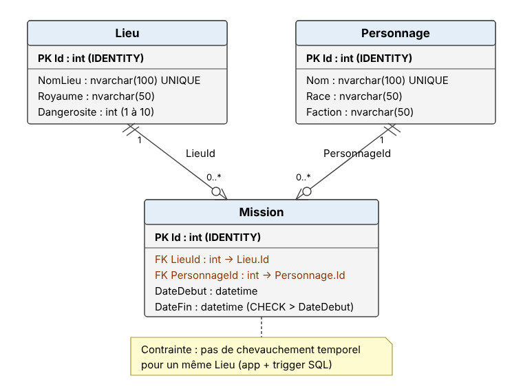
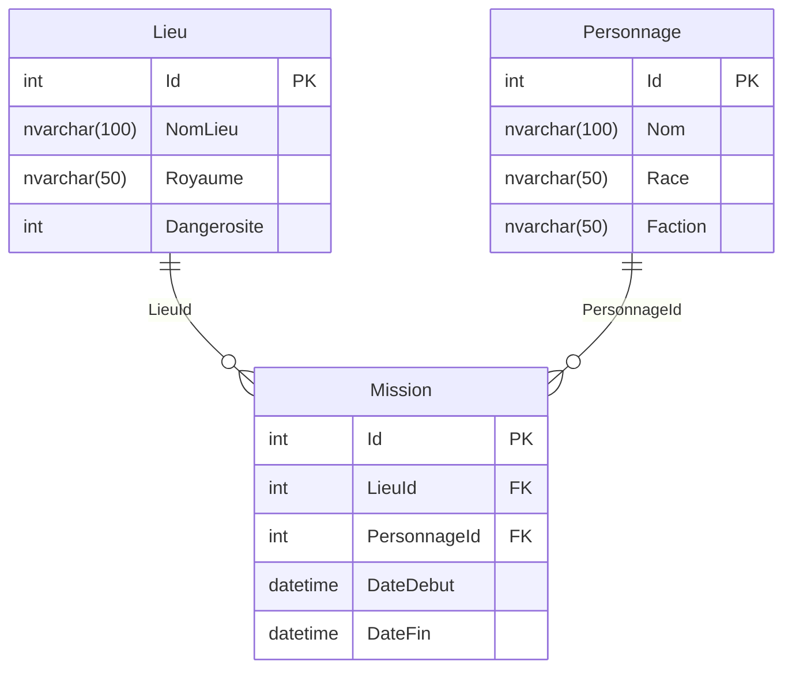
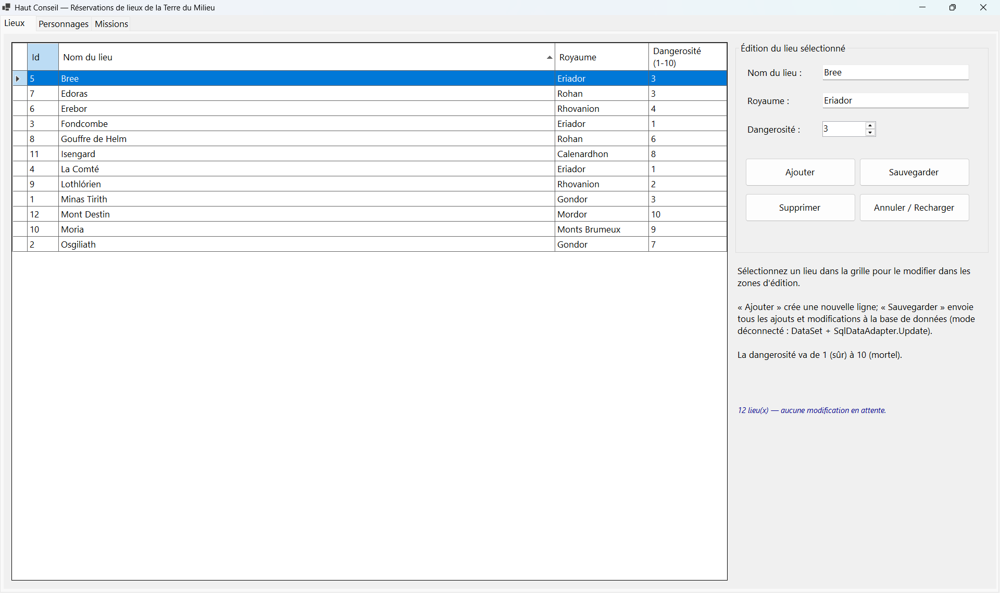
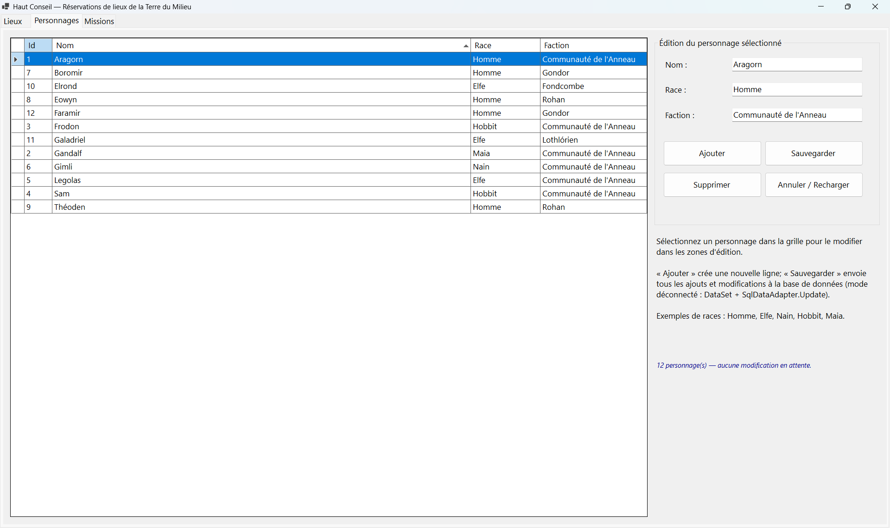
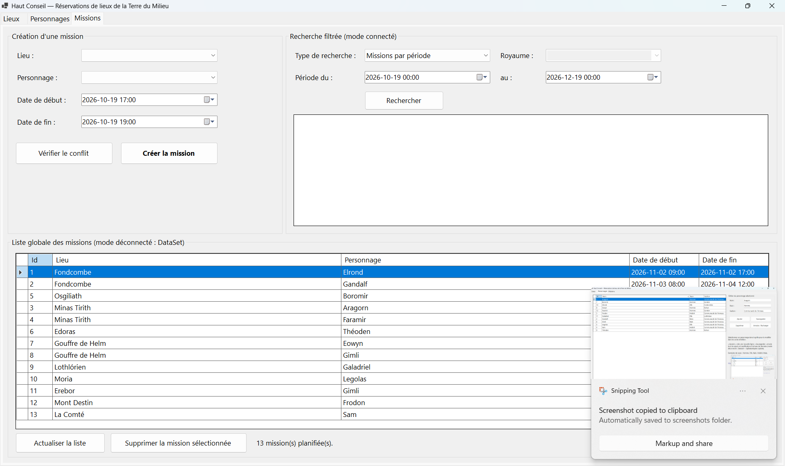
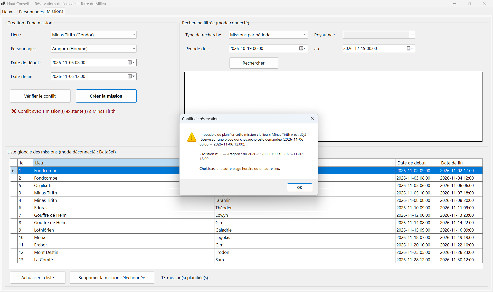

# Réservations de Lieux — Seigneur des Anneaux (WinForms, SQL FIRST, ADO.NET)

> TP#1 — 420-PA6-AG Programmation avancée de base de données — Institut Grasset — Automne 2026

## 1. Description

Le Haut Conseil de la Terre du Milieu a besoin d'un outil pour planifier des **missions**.
L'application permet de :

- gérer les **Lieux** (Minas Tirith, Fondcombe, Erebor…) : CRUD complet ;
- gérer les **Personnages** (Aragorn, Gandalf, Eowyn…) : CRUD complet ;
- planifier des **Missions** (un personnage, un lieu, une plage de temps) **sans chevauchement dans un même lieu**,
  rechercher des données avec des filtres et afficher toutes les missions.

**Technologies :** C# / .NET 8 (`net8.0-windows`), Windows Forms, SQL Server LocalDB,
ADO.NET pur (`System.Data.SqlClient`) en modes **connecté** et **déconnecté**, Repository Pattern.
Aucun Entity Framework, aucune migration : la base est créée par des **scripts SQL** (SQL FIRST).

**Architecture en couches :**

```
UI (WinForms)  ──►  Repositories (ADO.NET)  ──►  SQL Server (TP1_LSDA)
      │                     │
      └──── Domain (entités Lieu, Personnage, Mission) ────┘
```

L'interface ne contient **aucune requête SQL** : tout passe par les repositories.

## 2. Architecture

### Arborescence du projet

```
TP1_LSDA.sln
README.md
equipe.txt
docs/
  diagramme_bd.png / diagramme_bd.svg
Captures/                      ← captures d'écran (une par onglet)
TP1_LSDA/
  TP1_LSDA.csproj
  app.config                   ← connectionString « DefaultConnection »
  Program.cs                   ← point d'entrée + initialisation de la BD
  UI/
    FrmMain.cs                 ← fenêtre principale : 3 onglets exactement
    FrmLieux.cs                ← onglet 1 : CRUD déconnecté des lieux
    FrmPersonnages.cs          ← onglet 2 : CRUD déconnecté des personnages
    FrmMissions.cs             ← onglet 3 : création, conflit, recherche, liste
    UiHelper.cs                ← MessageBox et traduction des erreurs SQL
  Domain/
    Lieu.cs
    Personnage.cs
    Mission.cs
  Repositories/
    IRepository.cs             ← interface générique IRepository<T>
    RepositoryBase.cs          ← classe de base RepositoryBase<T>
    LieuRepository.cs
    PersonnageRepository.cs
    MissionRepository.cs
  Data/
    DatabaseInitializer.cs     ← exécute les scripts .sql au démarrage (ADO.NET)
  DatabaseScripts/
    create_database.sql
    create_tables.sql
    insert_data.sql
```

### Repository Pattern

| Élément | Rôle |
|---|---|
| `IRepository<T>` | Contrat générique : `GetAll`, `GetById`, `Add`, `Update`, `Delete` (mode connecté) et `GetDataSet`, `SaveChanges` (mode déconnecté). |
| `RepositoryBase<T>` | Classe abstraite qui **conserve la connectionString** et **gère l'ouverture/fermeture** des connexions (`using`). Elle factorise `ExecuteReader`, `ExecuteNonQuery`, `ExecuteScalar`, le `Delete` générique, ainsi que le remplissage du `DataSet` (`SqlDataAdapter.FillSchema` + `Fill`) et la sauvegarde (`SqlCommandBuilder` + `SqlDataAdapter.Update()` dans une transaction). |
| `LieuRepository`, `PersonnageRepository`, `MissionRepository` | Repositories spécialisés : ils fournissent le nom de table, le `SELECT`, le *mapping* `SqlDataReader → entité`, les `INSERT`/`UPDATE` paramétrés et les requêtes propres à chaque entité (recherches, détection de conflit, liste avec jointure). |

### Modes ADO.NET utilisés

| Mode | Classes | Utilisation dans l'application |
|---|---|---|
| **Connecté** | `SqlConnection`, `SqlCommand`, `SqlParameter`, `SqlDataReader` | Vérification de conflit avant insertion, recherches filtrées (missions par période, lieux par royaume, personnages par race, lieux disponibles), alimentation des combos, création et suppression d'une mission. **Toutes les requêtes sont paramétrées** (aucune concaténation de saisie utilisateur → aucune injection SQL possible). |
| **Déconnecté** | `SqlDataAdapter`, `DataSet`, `DataTable`, `SqlCommandBuilder` | CRUD des onglets Lieux et Personnages (`DataGridView` lié au `DataSet` par un `BindingSource`), puis `SqlDataAdapter.Update()` avec les commandes `INSERT/UPDATE/DELETE` générées par le `SqlCommandBuilder`. Liste globale des missions (`DataSet` rempli par une requête avec jointures). |

La sauvegarde déconnectée est **fiable** : elle est faite dans une transaction ; en cas d'erreur, rien n'est enregistré
et les modifications restent dans la grille pour être corrigées (`AcceptChangesDuringUpdate = false`, `AcceptChanges()` après le `Commit`).
Après chaque sauvegarde, les données sont rechargées depuis la BD (identifiants réels).

## 3. Base de données

### Diagramme





### Tables et contraintes

**Lieu**

| Colonne | Type | Contraintes |
|---|---|---|
| Id | int | `PK_Lieu`, IDENTITY(1,1) |
| NomLieu | nvarchar(100) | NOT NULL, `UQ_Lieu_NomLieu` (unique), `CK_Lieu_NomLieu` (non vide) |
| Royaume | nvarchar(50) | NOT NULL, `CK_Lieu_Royaume` (non vide) |
| Dangerosite | int | NOT NULL, défaut 1, `CK_Lieu_Dangerosite` (entre 1 et 10) |

**Personnage**

| Colonne | Type | Contraintes |
|---|---|---|
| Id | int | `PK_Personnage`, IDENTITY(1,1) |
| Nom | nvarchar(100) | NOT NULL, `UQ_Personnage_Nom` (unique), `CK_Personnage_Nom` (non vide) |
| Race | nvarchar(50) | NOT NULL, `CK_Personnage_Race` (non vide) |
| Faction | nvarchar(50) | NOT NULL, `CK_Personnage_Faction` (non vide) |

**Mission**

| Colonne | Type | Contraintes |
|---|---|---|
| Id | int | `PK_Mission`, IDENTITY(1,1) |
| LieuId | int | NOT NULL, `FK_Mission_Lieu` → `Lieu(Id)` |
| PersonnageId | int | NOT NULL, `FK_Mission_Personnage` → `Personnage(Id)` |
| DateDebut | datetime | NOT NULL |
| DateFin | datetime | NOT NULL, `CK_Mission_Dates` (`DateFin > DateDebut`) |

Autres objets :

- `IX_Mission_LieuId_Dates` : index qui accélère la détection de chevauchement par lieu ;
- `TR_Mission_PasDeChevauchement` : déclencheur (filet de sécurité côté serveur) qui refuse toute mission
  chevauchant une autre mission du **même lieu**. L'application vérifie le conflit **avant** l'insertion ;
  le déclencheur protège la BD même si deux utilisateurs réservent en même temps.

Règle de chevauchement : deux plages `[Début1, Fin1[` et `[Début2, Fin2[` se chevauchent si
`Début1 < Fin2 ET Fin1 > Début2`. Une mission qui commence exactement à l'heure où une autre se termine
**n'est pas** en conflit.

### Exécution des scripts (ordre recommandé)

1. `create_database.sql` — crée la base `TP1_LSDA` (connecté sur `master`) ;
2. `create_tables.sql` — crée les tables, clés, contraintes, index et déclencheur (ré-exécutable) ;
3. `insert_data.sql` — insère les données d'essai (12 lieux, 12 personnages, 13 missions ; ré-exécutable).

**Deux façons de faire :**

- **Automatique (recommandé)** : au premier lancement, si la base ou ses tables n'existent pas, l'application
  exécute elle-même les trois scripts via ADO.NET (`Data/DatabaseInitializer.cs`, lots séparés par `GO`).
- **Manuelle (SSMS)** : se connecter à `(localdb)\mssqllocaldb`, ouvrir les trois fichiers du dossier
  `TP1_LSDA/DatabaseScripts` et les exécuter dans l'ordre ci-dessus.

Pour remettre les données d'essai à zéro : ré-exécuter `insert_data.sql` (ou `create_tables.sql` puis `insert_data.sql`).

## 4. Exécution

### Prérequis

- Windows 10/11 ;
- Visual Studio 2022 (charge de travail **Développement .NET Desktop**) avec le SDK .NET 8 ;
- SQL Server **LocalDB** (`mssqllocaldb`, installé avec Visual Studio) ; SSMS est facultatif.

### Lancer la solution

1. Ouvrir `TP1_LSDA.sln` dans Visual Studio ;
2. Compiler (les paquets NuGet `System.Data.SqlClient` et `System.Configuration.ConfigurationManager` sont restaurés automatiquement) ;
3. Lancer (F5). Au premier démarrage, un message confirme la création de la base à partir des scripts.

### ConnectionString

Elle se trouve dans `TP1_LSDA/app.config` (non modifiée) :

```xml
<connectionStrings>
  <add name="DefaultConnection"
       connectionString="Server=(localdb)\mssqllocaldb;Database=TP1_LSDA;Trusted_Connection=True;MultipleActiveResultSets=true"
       providerName="System.Data.SqlClient" />
</connectionStrings>
```

Elle est lue avec `ConfigurationManager.ConnectionStrings["DefaultConnection"]` dans `Program.cs`, puis transmise aux repositories.

### Données d'essai

Aucun compte n'est nécessaire. Les données insérées par `insert_data.sql` comprennent, par exemple :

| Mission | Lieu | Personnage | Début | Fin |
|---|---|---|---|---|
| 3 | Minas Tirith | Aragorn | 2026-11-05 10:00 | 2026-11-07 18:00 |
| 4 | Minas Tirith | Faramir | 2026-11-08 08:00 | 2026-11-08 20:00 |
| 1 | Fondcombe | Elrond | 2026-11-02 09:00 | 2026-11-02 17:00 |
| 2 | Fondcombe | Gandalf | 2026-11-03 08:00 | 2026-11-04 12:00 |
| 12 | Mont Destin | Frodon | 2026-11-25 05:00 | 2026-11-26 23:00 |

## 5. Fonctionnalités

L'application contient **exactement 3 onglets**.

### Onglet 1 — Lieux (mode déconnecté)

- `dgvLieux` affiche tous les lieux (DataSet) ; cliquer sur une ligne la charge dans les zones d'édition
  **NomLieu**, **Royaume**, **Dangerosite** (1 à 10).
- **Ajouter** : crée une nouvelle ligne vide à remplir.
- **Sauvegarder** : valide toutes les lignes puis envoie les ajouts/modifications à la BD (`SqlDataAdapter.Update`).
- **Supprimer** : demande une confirmation, supprime le lieu et enregistre. Un lieu utilisé par une mission ne peut pas
  être supprimé (message clair).
- **Annuler / Recharger** : abandonne les modifications en attente.
- Un libellé indique le nombre de modifications en attente ; un avertissement apparaît si l'on quitte l'onglet sans sauvegarder.

### Onglet 2 — Personnages (mode déconnecté)

Même fonctionnement avec `dgvPersonnages` et les zones **Nom**, **Race**, **Faction**.

### Onglet 3 — Missions

- **Création** : choisir un lieu (`cbLieu`), un personnage (`cbPersonnage`), la date de début (`dtpDebut`) et de fin (`dtpFin`),
  puis **Créer la mission**. Le conflit est vérifié **avant l'insertion** par une requête paramétrée lue avec un `SqlDataReader` ;
  en cas de conflit, la mission n'est pas créée et le message liste les missions en conflit.
  Le bouton **Vérifier le conflit** permet de tester une plage sans rien créer.
- **Recherche filtrée (mode connecté)** : choisir le type de recherche, renseigner le filtre puis cliquer sur **Rechercher** ;
  les résultats s'affichent dans `dgvResultats`.
  - *Missions par période* : missions qui se déroulent, même en partie, entre les deux dates ;
  - *Lieux par royaume* : choisir ou taper un royaume (recherche partielle, ex. « Gon » → Gondor) ;
  - *Personnages par race* : choisir ou taper une race (ex. « Hobbit ») ;
  - *Lieux disponibles sur une période* : lieux sans aucune mission qui chevauche la période.
- **Liste globale (mode déconnecté)** : `dgvMissions` affiche toutes les missions (DataSet) avec le nom du lieu et du personnage
  (jointure). Boutons **Actualiser la liste** et **Supprimer la mission sélectionnée**.

Les combos de lieux et de personnages sont rechargés chaque fois que l'on revient sur l'onglet Missions.

## 6. Tests / Validation

### Cas de conflit attendu

| # | Lieu | Début | Fin | Résultat attendu |
|---|---|---|---|---|
| 1 | Minas Tirith | 2026-11-06 08:00 | 2026-11-06 12:00 | **Refusé** : chevauche la mission n° 3 d'Aragorn (05/11 10:00 → 07/11 18:00) |
| 2 | Minas Tirith | 2026-11-04 12:00 | 2026-11-05 11:00 | **Refusé** : la fin dépasse le début de la mission d'Aragorn |
| 3 | Minas Tirith | 2026-11-07 18:00 | 2026-11-08 08:00 | **Accepté** : commence quand la mission d'Aragorn finit et finit quand celle de Faramir commence |
| 4 | Osgiliath | 2026-11-06 12:00 | 2026-11-06 14:00 | **Accepté** : même période, mais autre lieu |

### Cas de saisies invalides

| Saisie | Message attendu |
|---|---|
| Aucun lieu ou aucun personnage choisi | « Veuillez choisir un lieu. » / « Veuillez choisir un personnage. » |
| Date de fin avant (ou égale à) la date de début | « La date de fin doit être strictement postérieure à la date de début. » |
| Mission de plus de 365 jours | « Une mission ne peut pas durer plus de 365 jours. » |
| Date de début passée | Demande de confirmation |
| Lieu sans nom ou sans royaume, puis Sauvegarder | « Le nom du lieu est obligatoire. » / « … le royaume est obligatoire. » |
| Deux lieux (ou personnages) du même nom | « … ce nom de lieu est en double. » (et contrainte `UNIQUE` en BD) |
| Supprimer « Minas Tirith » (utilisé par des missions) | « Cet élément est utilisé par au moins une mission… » |
| Recherche par période avec dates inversées | « La date de fin de la période doit être postérieure à la date de début. » |
| BD inaccessible | Message expliquant de vérifier LocalDB ou d'exécuter les scripts dans SSMS |

## 7. Captures d'écran

| Onglet Lieux | Onglet Personnages | Onglet Missions |
|---|---|---|
|  |  |  |

Exemple de conflit détecté :



## 8. Équipe

| Membre | Rôle | Tâches |
|---|---|---|
| Yaya Diallo | Base de données et accès aux données | Scripts SQL (tables, contraintes, déclencheur, données d'essai), `IRepository<T>`, `RepositoryBase<T>`, repositories spécialisés, initialisation automatique de la BD |
| Ayman-Abdelaziz Chanboun | Interface et validation | Formulaires WinForms (3 onglets), liaison DataSet/DataGridView, création de mission et vérification de conflit, recherches, validation et messages d'erreur |
| Les deux | Documentation et tests | README, diagramme BD, captures d'écran, tests des cas de conflit et des saisies invalides |
